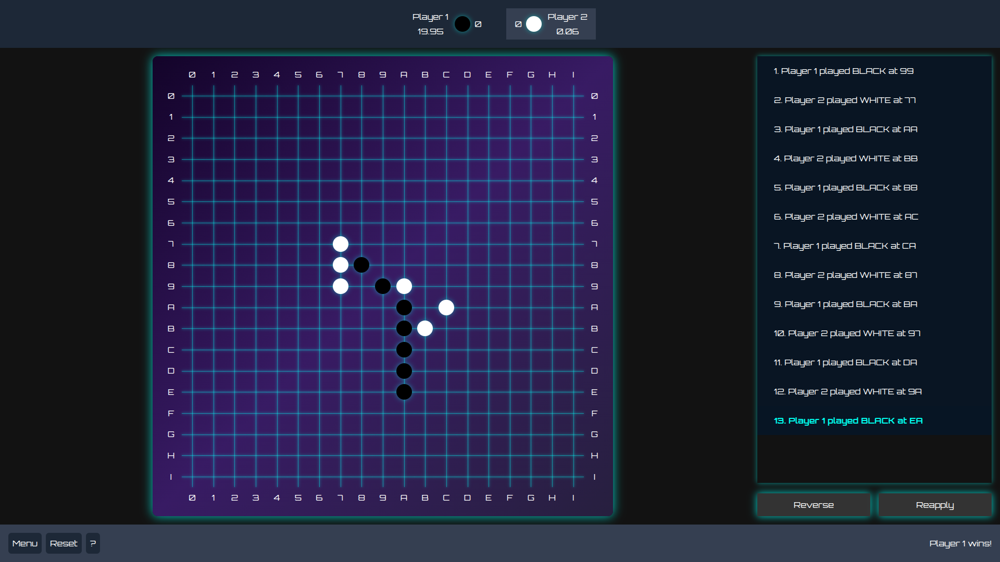
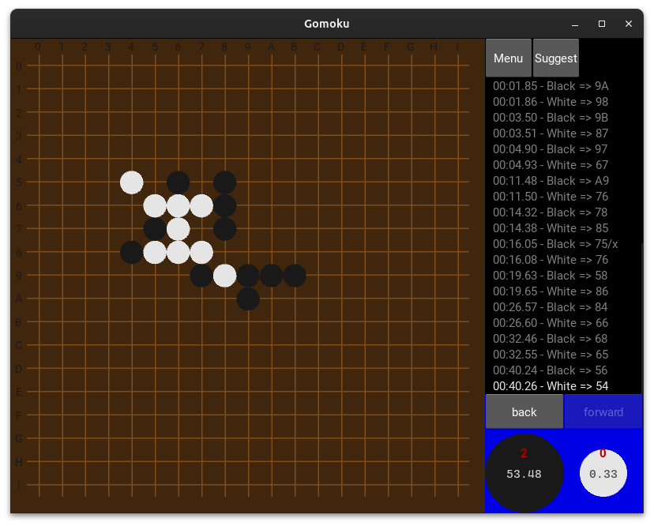
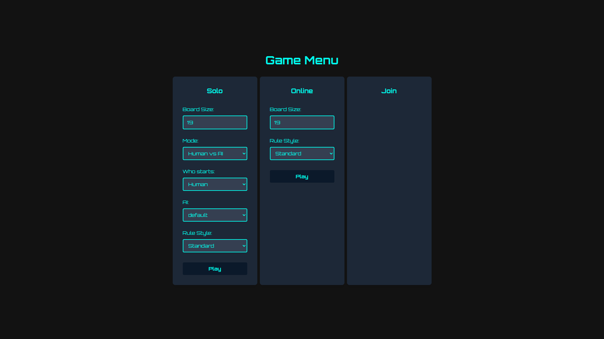

# Gomoku – Unbeatable(ish) AI with Multi‑Platform Play

> **C++ engine + Python bindings + Kivy UI + React/Flask WebApp**
> Play Gomoku against advanced AIs or challenge friends online. The goal of this project is simple: **build an unbeatable Gomoku AI.**

<p align="center">
  <br/>
  <em>Web – Online room & play</em>
</p>

---

## 🌟 Highlights

- **Highly optimized C++ engine**
  - Minimax + **alpha–beta pruning**
  - **Iterative deepening** with **quiescence search** (depth 7 baseline, up to 10 in < 0.5s/move)
  - **Killer move heuristic** & **move ordering**
  - **Pattern recognition** with **incremental updates** and memoized transitions (O(1))
  - **Capture rules** supported (5 captures = win; an aligned 5 only counts if **not capturable**)
- **Multiple AI opponents**
  - Several AI profiles with distinct evaluation styles. Some have deliberate **“blind spots”** that make them beatable — great for training and fun challenges.
- **Multi‑platform play**
  - 🖥️ **Local UI** with Kivy
  - 🌐 **Web app** (React + Flask + Socket.IO) for solo vs AI or online PvP *(local run)*
- **Robust testing**
  - Extensive unit tests on the engine
  - A curated suite of **AI puzzles** (tactical scenarios) to validate strategic correctness
- **Analytics**
  - Move evaluation logs exportable to **CSV**
  - Depth distribution plots in `/plots`

---

## 🕹 Rules Implemented

- **Board sizes**: 10×10 → 25×25 (default **19×19**)
- **Winning conditions**:
  - Align **five stones** (only if the chain **cannot be captured**), **or**
  - Achieve **five captures**
- **Rule styles**: Standard, Pro, Long Pro, Swap, Swap2
- **Captures**: sandwiched pairs are removed (adds deep tactical complexity)

> Without capture checks the engine would run ~**5× faster**, but the richer rules make the AI much more interesting and challenging.

---

## 📊 Performance (on typical desktop)

| Algorithm stage      | Depth reached | Avg. move time |
|---------------------|---------------|----------------|
| Naive minimax       | 3             | < 0.5 s        |
| Optimized (α–β etc.)| 7             | < 0.5 s        |
| + Quiescence        | **10**        | < 0.5 s        |

> In practice, the AI has **never been beaten** during testing.

---

## 🧩 Testing Strategy

- **Engine unit tests** (C++), runnable via CMake/Make.
- **AI “puzzles”**: short positions with a clearly best move (win/find, defend, capture vs block, fork creation, etc.).
  - If the AI consistently solves simple/forced motifs, it is far more reliable in complex games.

---

## 📂 Repository Structure

```
.
├── GomokuEngine   # C++ engine + pybind bindings
├── GomokuKivy     # Local UI (Kivy, PyInstaller)
├── GomokuBack     # Flask + Socket.IO backend (local only)
├── GomokuFront    # React + Tailwind frontend (local only)
├── lib/pygomoku.so
├── Docs
├── plots
└── resources
```

---

## ⚙️ Build & Run (Local)

> Requirements: CMake ≥ 3.16, a C++17 compiler, Python 3.9+, Node.js (for the web UI).

```bash
# 1) Clone
git clone https://your-repository-url/gomoku.git
cd gomoku

# 2) Python env
python3 -m venv venv
source venv/bin/activate

# 3) Install Python deps
pip install -r requirements.txt

# 4) Init submodules
git submodule update --init --recursive

# 5) Build engine and Kivy app
make

# 6) Run the desktop client
./Gomoku
```

### Web app (optional, local)

```bash
# Backend
cd GomokuBack
source ../venv/bin/activate
python server_gomoku.py

# Frontend
cd ../GomokuFront
npm install
npm start
```

---

## 🧩 Engine Internals (C++)

- **Core**: `GomokuEngine/include/engine/gomoku_engine.h`
  - Incremental updates of pattern counts after each move
  - Relevancy map to prune the move list (bounds + local scoring)
- **Pattern recognition**: `gomoku_pattern_reconizer.*`
  - Tracks **open/closed 1–4**, **open-three with gap**, **fives+**, and **capturable formations**
  - Updates with O(1) **memoized** cell transitions
- **Search**: `ai/gomoku_ai_minmaxv3.*`
  - Minimax + alpha–beta, **killer moves**, **move ordering**
  - **Deepening & quiescence**: extends promising lines beyond the nominal depth
  - CSV logging of explored trees

Bindings via **pybind11** expose the engine to Python (Kivy and Flask).

---

## 🧪 Quick Test

```bash
make -C GomokuEngine test
```

You can also run the curated **puzzles** suite (see Docs) to validate typical tactical motifs.

---

## 🖼️ Screenshots

<p align="center">
  <br/>
  <em>Kivy Desktop – Gameplay</em>
</p>

<p align="center">
  <br/>
  <em>Web – Menu & options</em>
</p>

<p align="center">
  <br/>
  <em>Web – Online room & play</em>
</p>

---

## 🔄 Continuous integration

Every push on the `main` branch triggers the full test suite to ensure continuous integration.

[View workflow](.github/workflows/gomoku-engine-tests.yml)

---

## 🔭 Roadmap

- Online matchmaking & ELO
- Dockerized local stack
- Additional AI personalities (more “human” flaws)
- Mobile‑friendly layouts

---

## 👤 Author

Built by **Antoine Labalette** & **Arthur Masson**

---

> This project showcases advanced engine optimization (C++), heuristic AI design, Python/C++ bindings, and real‑time web UX.
